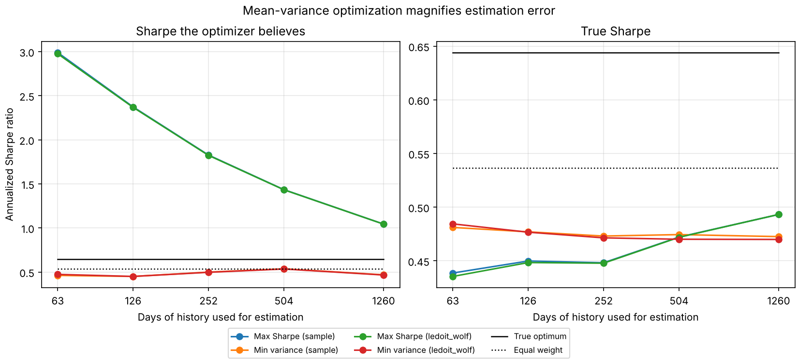
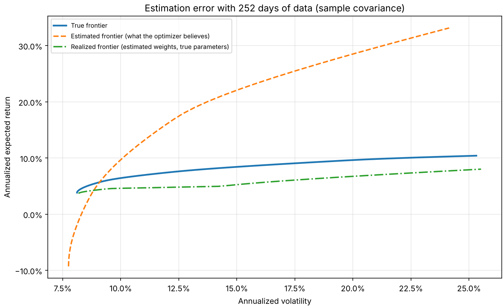
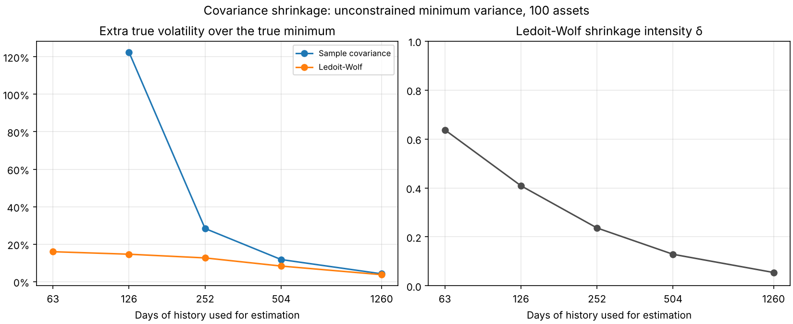

# Project 3: Portfolio optimizer

Markowitz mean-variance optimization, Ledoit-Wolf shrinkage, Black-Litterman, risk parity
and Hierarchical Risk Parity, all implemented from first principles in
[`src/quantfin/portfolio/`](../src/quantfin/portfolio), then compared out of sample.

**Key lesson:** mean-variance optimization magnifies small errors in its inputs, so the
"optimal" portfolio often does badly on new data. Shrinkage helps. Methods that rely less
on noisy expected-return estimates (minimum variance, risk parity, HRP, 1/N) are usually
more robust.

## Quick start

```bash
pip install -e ".[dev,data]"

# Efficient frontier and every portfolio type on 12 multi-asset ETFs (downloads from Yahoo)
python -m quantfin.portfolio frontier

# Walk-forward backtest of 9 strategies, net of 10 bp trading costs
python -m quantfin.portfolio backtest --lookback 504 --rebalance 21 --cost-bps 10

# The key lesson, measured exactly: Monte Carlo with known true parameters
python -m quantfin.portfolio experiment --trials 200

# Any command also runs offline on a synthetic market, or on your own price file
python -m quantfin.portfolio backtest --source synthetic
python -m quantfin.portfolio frontier --source csv --csv my_prices.csv
```

Each command prints its tables and saves CSVs and charts under `results/<command>/`.
Useful options include `--tickers`, `--start`, `--end`, `--rf 0.02` and `--out DIR`. Run
`python -m quantfin.portfolio <command> --help` for all of them.

## Module map

| Module | What it implements | Checked against |
|---|---|---|
| `estimators.py` | Sample, EWMA and Ledoit-Wolf covariance (identity and constant-correlation targets); mean estimators | scikit-learn's `ledoit_wolf`; a loop-based re-implementation of `covCor.m` |
| `markowitz.py` | Min variance, max Sharpe, efficient return/risk, utility, efficient frontier | Closed forms; KKT conditions; two-fund separation |
| `black_litterman.py` | Reverse optimization, views, He-Litterman and Idzorek Ω, posterior | Precision-form identity; limiting cases (no views, certain views) |
| `risk_parity.py` | Risk contributions, inverse vol/variance, equal risk contribution (Newton on Spinu's convex form) | 2-asset closed form; equal contributions; budgets |
| `hrp.py` | Hierarchical Risk Parity (López de Prado, 2016) | Paper's algorithm re-implemented; reduces to inverse variance when correlations are 0 |
| `backtest.py` | Walk-forward backtester with weight drift, turnover and costs | Spy strategy proves no look-ahead; hand-computed drift and costs |
| `metrics.py` | CAGR, volatility, Sharpe, Sortino, drawdowns, Calmar, VaR/ES, diversification | Hand-computed values |
| `strategies.py` | The 9 strategies compared in the backtest | Wrappers match direct optimizer calls |
| `experiments.py` | Known-truth Monte Carlo: believed vs true Sharpe; true/estimated/realized frontiers; covariance shrinkage study | Optimality: no portfolio beats the true optimum |
| `data.py` | Yahoo/CSV loaders, return cleaning, synthetic factor-model market with known truth | Simulated moments converge to the truth |
| `plots.py`, `cli.py` | Charts and the `python -m quantfin.portfolio` command | End-to-end CLI tests |

Conventions: daily simple returns; expected returns, covariances and the risk-free rate
are annualized with 252 trading days; weights sum to 1 and are long-only unless you pass
`bounds=None`.

## Theory

### 1. Mean-variance optimization (Markowitz, 1952)

With expected returns $\mu$, covariance $\Sigma$ and weights $w$ that sum to 1, a portfolio
has return $w^\top\mu$ and variance $w^\top\Sigma w$. With short sales allowed, the
problems have closed forms:

* **Global minimum variance:** $w_{\text{mv}} = \dfrac{\Sigma^{-1}\mathbf{1}}{\mathbf{1}^\top\Sigma^{-1}\mathbf{1}}$
* **Tangency (maximum Sharpe):** $w_{\text{tan}} = \dfrac{\Sigma^{-1}(\mu - r_f\mathbf{1})}{\mathbf{1}^\top\Sigma^{-1}(\mu - r_f\mathbf{1})}$
* **Frontier:** with $A = \mathbf{1}^\top\Sigma^{-1}\mathbf{1}$, $B = \mathbf{1}^\top\Sigma^{-1}\mu$,
  $C = \mu^\top\Sigma^{-1}\mu$ and $D = AC - B^2$, the minimum variance for target return
  $m$ is $\sigma^2(m) = (Am^2 - 2Bm + C)/D$. Every frontier portfolio is a mix of two
  frontier funds (two-fund separation).

Long-only and other bounds remove the closed forms, so the code uses SLSQP with analytic
gradients. The maximum Sharpe ratio is not a convex objective, so it is solved through
the equivalent convex problem $\min_y y^\top\Sigma y$ subject to
$(\mu - r_f)^\top y = 1$ and $y \ge 0$, then $w = y / \mathbf{1}^\top y$
(Cornuejols & Tütüncü).

### 2. Why the "optimal" portfolio disappoints: estimation error

The optimizer treats $\hat\mu$ and $\hat\Sigma$ as if they were the truth, but they are
noisy:

* The standard error of an annualized mean is $\sigma/\sqrt{\text{years}}$. For an asset
  with 20% volatility and 5 years of data, that is about **8.9% per year**, which is larger
  than the expected return being estimated.
* A covariance matrix has $N(N+1)/2$ parameters. When the number of assets $N$ is not
  small relative to the number of observations $T$, the smallest eigenvalues of
  $\hat\Sigma$ are biased toward zero, and $\Sigma^{-1}$ amplifies exactly those directions.

The optimizer then loads up on the assets whose returns were overestimated and whose
risks were underestimated. Michaud (1989) called mean-variance optimization an
"estimation-error maximizer". Two symptoms follow:

1. The Sharpe ratio the optimizer **believes** it achieves is biased upward.
2. The Sharpe ratio it **actually** achieves, scored with the true parameters, is below
   the true optimum, sometimes below naive 1/N (DeMiguel, Garlappi & Uppal, 2009).

`experiments.py` measures both exactly by simulating from known true parameters (see
[Results](#results)).

### 3. Ledoit-Wolf shrinkage

Shrink the sample covariance $S$ toward a structured target $F$:
$\hat\Sigma = \delta F + (1-\delta) S$. The intensity $\delta$ minimizes the expected
squared Frobenius distance to the true covariance. Its estimate is
$\hat\delta = \max(0, \min(1, \hat\kappa / T))$ with $\hat\kappa = (\hat\pi - \hat\rho)/\hat\gamma$:

* $\hat\pi$: the sum of asymptotic variances of the entries of $S$ (how noisy $S$ is);
* $\hat\rho$: the sum of asymptotic covariances between $F$ and $S$;
* $\hat\gamma = \lVert F - S\rVert_F^2$: how far the target is from the data (misspecification).

Two targets are implemented:

* **Constant correlation** (Ledoit & Wolf, 2003/2004, "Honey, I shrunk the sample
  covariance matrix"). Each variance is kept, and every correlation is replaced by the
  average correlation $\bar r$. This is the default because it suits assets with
  heterogeneous volatilities.
* **Scaled identity** (Ledoit & Wolf, 2004, "A well-conditioned estimator..."). The
  target is $F = (\operatorname{tr} S / N) I$. It matches scikit-learn's `ledoit_wolf`
  to $10^{-10}$.

More data means less noise, so $\hat\delta \to 0$ as $T$ grows.

### 4. Black-Litterman (Black & Litterman, 1992; He & Litterman, 1999)

Instead of noisy historical means, start from the returns that would make the market
portfolio optimal, and tilt them only where you have views.

1. **Prior (reverse optimization):** $\pi = \delta\,\Sigma\,w_{\text{mkt}}$, where
   $\delta$ is the market's risk aversion. The prior's optimal portfolio is
   $w_{\text{mkt}}$ itself.
2. **Views:** $P\mu = Q + \varepsilon$, $\varepsilon \sim N(0, \Omega)$. Each row of $P$
   is one view, absolute ("A returns 5%") or relative ("A beats B by 2%").
3. **Posterior** (written in a form that stays valid when $\Omega$ is singular, i.e. for
   views held with certainty):

   $$\mu_{BL} = \pi + \tau\Sigma P^\top (P\tau\Sigma P^\top + \Omega)^{-1}(Q - P\pi), \qquad
   \Sigma_{BL} = \Sigma + \tau\Sigma - \tau\Sigma P^\top (P\tau\Sigma P^\top + \Omega)^{-1}P\tau\Sigma$$

4. **View uncertainty $\Omega$:** He-Litterman uses $\operatorname{diag}(P\tau\Sigma P^\top)$.
   Idzorek's method sets each view's confidence $c_k \in (0, 1]$ directly. It reduces to
   $\omega_k = \frac{1-c_k}{c_k}\,p_k\tau\Sigma p_k^\top$ (Walters).

The backtest strategy uses an equal-weight prior, because market caps of a multi-asset
ETF universe are not available. Its views are each asset's trailing 12-1 month momentum,
held at 25% confidence. The result is a portfolio that tilts toward momentum while staying
anchored to a diversified prior.

### 5. Risk parity: equal risk contribution (Maillard, Roncalli & Teiletche, 2010)

Volatility is homogeneous of degree one in the weights, so it splits exactly into risk
contributions:

$$\sigma_p = \sum_i RC_i, \qquad RC_i = \frac{w_i(\Sigma w)_i}{\sigma_p}.$$

ERC makes every $RC_i$ equal; risk budgeting makes $RC_i/\sigma_p = b_i$. Following
Spinu (2013), the solution is $w = y / \mathbf{1}^\top y$, where $y$ solves the strictly
convex problem

$$\min_{y > 0}\ \tfrac12 y^\top\Sigma y - \sum_i b_i \ln y_i,$$

whose first-order condition $y_i(\Sigma y)_i = b_i$ is exactly the budget condition. The
code solves it with a damped Newton method. ERC needs no expected returns. For two
assets it is $w_i \propto 1/\sigma_i$ for any correlation.

### 6. Hierarchical Risk Parity (López de Prado, 2016)

HRP avoids inverting $\Sigma$, which is the step that amplifies estimation error.

1. **Tree clustering:** correlation distance $d_{ij} = \sqrt{(1-\rho_{ij})/2}$, then the
   "distance of distances" $\tilde d_{ij} = \lVert d_{\cdot i} - d_{\cdot j}\rVert_2$, then
   single-linkage clustering.
2. **Quasi-diagonalization:** reorder assets by the dendrogram so similar assets sit next
   to each other.
3. **Recursive bisection:** split the ordered list in halves. Give each half the inverse
   variance of its inverse-variance sub-portfolio, using
   $\alpha = 1 - V_1/(V_1+V_2)$, and recurse.

When all correlations are zero, HRP reduces exactly to inverse-variance weights (proved
in the tests).

## Backtest methodology

`walk_forward_backtest` avoids the usual ways backtests fool you:

* **No look-ahead.** At each rebalance date $t$ the strategy sees only rows
  $t - L, \dots, t-1$. A spy strategy in the tests proves it.
* **Realistic holdings.** Between rebalances, weights drift with prices
  ($w \leftarrow w \circ (1+r)/(1 + w^\top r)$) instead of being magically reset every day.
* **Costs.** Each rebalance pays `cost_bps` on its turnover $\sum_i |w^{\text{target}}_i - w^{\text{drifted}}_i|$,
  including the initial purchase from cash.
* **Same data, same dates.** Every strategy uses the same windows and rebalance dates, so
  differences come from the method alone.

The 9 strategies isolate one effect at a time:

* sample vs Ledoit-Wolf covariance under the same optimizer;
* methods that need expected returns (max Sharpe, Black-Litterman) vs risk-only methods
  (min variance, ERC, HRP, inverse volatility);
* the 1/N benchmark.

## Results

These results come from **known-truth Monte Carlo experiments**: returns are simulated
from a synthetic 12-asset factor market whose true expected returns and covariance are
known exactly. That is the only way to measure estimation error directly, because in
real data the truth is never observed. They illustrate the method; they are not a
claim about any real market. To reproduce them:

```bash
python -m quantfin.portfolio experiment --source synthetic                # 12 assets, 200 trials
python -m quantfin.portfolio experiment --source synthetic --n-assets 100 --trials 50
```

To run the same experiment calibrated to real ETF data (full-sample estimates are used
as the truth), and the walk-forward backtest on real prices:

```bash
python -m quantfin.portfolio experiment
python -m quantfin.portfolio backtest
```

### Experiment 1: the optimizer is overconfident, and its "optimal" portfolio underperforms

200 simulated histories per sample size, long-only weights, rf = 0. The *believed*
Sharpe ratio uses the estimated parameters the optimizer saw. The *true* Sharpe ratio
scores the same weights with the true parameters.

| Days of data | Max Sharpe: believed | Max Sharpe: true | Max Sharpe (Ledoit-Wolf): true | Min variance: true | Equal weight: true | True optimum |
|---|---|---|---|---|---|---|
| 63 (~3 months) | 2.99 | 0.44 | 0.44 | 0.48 | 0.54 | 0.64 |
| 126 (~6 months) | 2.37 | 0.45 | 0.45 | 0.48 | 0.54 | 0.64 |
| 252 (~1 year) | 1.83 | 0.45 | 0.45 | 0.47 | 0.54 | 0.64 |
| 504 (~2 years) | 1.43 | 0.47 | 0.47 | 0.47 | 0.54 | 0.64 |
| 1260 (~5 years) | 1.04 | 0.49 | 0.49 | 0.47 | 0.54 | 0.64 |



What this shows:

* **Overconfidence.** With one year of data the optimizer believes its portfolio has a
  Sharpe ratio of 1.83. Its true Sharpe ratio is 0.45, which is 70% of the true optimum.
  Even with five years of data, it believes 1.04 against a true 0.49.
* **The "optimal" portfolio loses to naive 1/N** (0.54) at every sample size. This is the
  DeMiguel, Garlappi & Uppal (2009) result: the gain from optimizing is smaller than the
  loss from estimation error.
* **Ledoit-Wolf does not fix max Sharpe.** Errors in the expected returns dominate here:
  the standard error of a mean is about $\sigma/\sqrt{\text{years}}$, much larger than its
  effect on the covariance. Chopra & Ziemba (1993) estimated that errors in the means
  cost roughly 10 times as much as errors in the covariances. The remedies for the means
  are different: ignore them (min variance, risk parity, HRP), or shrink them toward an
  equilibrium prior (Black-Litterman).

The picture behind the numbers (Broadie, 1993):



* The **estimated** frontier, the one the optimizer believes in, is far too optimistic.
* The **realized** frontier, which uses the same weights scored with the true
  parameters, lies below the **true** frontier at every risk level.

### Experiment 2: where Ledoit-Wolf shrinkage pays off

Minimum variance needs no expected returns, so it isolates covariance error. The table
shows the true volatility of the estimated unconstrained minimum-variance portfolio, as
extra risk over the true minimum. It uses 100 assets and 50 trials per sample size.

| Days of data | Sample covariance | Ledoit-Wolf | Shrinkage intensity δ |
|---|---|---|---|
| 63 | undefined (T < N, singular) | +16.0% | 0.64 |
| 126 | **+122.4%** | **+14.6%** | 0.41 |
| 252 | +28.3% | +12.7% | 0.24 |
| 504 | +11.8% | +8.3% | 0.13 |
| 1260 | +4.2% | +3.7% | 0.05 |



* With 100 assets and six months of data, the sample covariance more than doubles the
  risk of the "minimum-variance" portfolio. Ledoit-Wolf cuts the excess to about 15%.
* Shrinkage works even when there are fewer observations than assets, where the sample
  covariance cannot be inverted at all.
* The estimated intensity $\hat\delta$ falls toward 0 as data accumulates, exactly as
  the theory says it should.
* With 12 assets the benefit is small (a few percent), and with **long-only** weights it
  mostly disappears. The no-short-sale constraint itself acts like covariance shrinkage
  (Jagannathan & Ma, 2003). So whether shrinkage "helps" depends on N/T and on your
  constraints. Measure it rather than assume it.

### Backtest on real data

The walk-forward backtest compares the 9 strategies on real ETF prices:

```bash
python -m quantfin.portfolio backtest --lookback 504 --rebalance 21 --cost-bps 10
```

It prints CAGR, volatility, Sharpe, Sortino, max drawdown, Calmar, VaR/ES and annual
turnover, and saves wealth and drawdown charts. When reading it, keep the caveats below
in mind. One historical path cannot rank strategies whose Sharpe ratios differ by 0.1.
Turnover and drawdowns are often more informative than CAGR.

## Limitations and honest caveats

* **One historical path.** A backtest is a single draw. Differences of 0.1–0.2 in Sharpe
  ratio between strategies are usually within noise. The Monte Carlo experiment exists
  because it does not have this problem.
* **Universe chosen with hindsight.** The default ETFs are ones that exist today
  (survivorship bias). The universe is broad and fixed, which limits the damage.
* **Simple cost model.** Costs are linear in turnover, with no market impact, bid-ask
  dynamics or taxes.
* **Risk-free rate.** It defaults to 0. Pass `--rf` to use a constant annual rate.
  Time-varying rates are not modeled.
* **Black-Litterman prior.** It uses equal weights as a stand-in for market-cap weights,
  and its momentum views are one simple, systematic choice among many.
* **Data quality.** yfinance is an unofficial Yahoo Finance client. Adjusted prices
  include dividends, but check gaps and outliers before trusting results.

## References

* Markowitz, H. (1952). Portfolio Selection. *Journal of Finance*.
* Michaud, R. (1989). The Markowitz Optimization Enigma: Is 'Optimized' Optimal? *Financial Analysts Journal*.
* Black, F. & Litterman, R. (1992). Global Portfolio Optimization. *Financial Analysts Journal*.
* Broadie, M. (1993). Computing efficient frontiers using estimated parameters. *Annals of Operations Research*.
* Chopra, V. & Ziemba, W. (1993). The Effect of Errors in Means, Variances, and Covariances on Optimal Portfolio Choice. *Journal of Portfolio Management*.
* He, G. & Litterman, R. (1999). The Intuition Behind Black-Litterman Model Portfolios. Goldman Sachs.
* Jagannathan, R. & Ma, T. (2003). Risk Reduction in Large Portfolios: Why Imposing the Wrong Constraints Helps. *Journal of Finance*.
* Ledoit, O. & Wolf, M. (2003). Improved estimation of the covariance matrix of stock returns with an application to portfolio selection. *Journal of Empirical Finance*.
* Ledoit, O. & Wolf, M. (2004). Honey, I Shrunk the Sample Covariance Matrix. *Journal of Portfolio Management*.
* Ledoit, O. & Wolf, M. (2004). A well-conditioned estimator for large-dimensional covariance matrices. *Journal of Multivariate Analysis*.
* Idzorek, T. (2005). A Step-by-Step Guide to the Black-Litterman Model.
* DeMiguel, V., Garlappi, L. & Uppal, R. (2009). Optimal Versus Naive Diversification. *Review of Financial Studies*.
* Maillard, S., Roncalli, T. & Teiletche, J. (2010). The Properties of Equally Weighted Risk Contribution Portfolios. *Journal of Portfolio Management*.
* Spinu, F. (2013). An Algorithm for Computing Risk Parity Weights. SSRN.
* Walters, J. (2014). The Black-Litterman Model in Detail. SSRN.
* López de Prado, M. (2016). Building Diversified Portfolios that Outperform Out of Sample. *Journal of Portfolio Management*.
* Cornuejols, G. & Tütüncü, R. (2007). *Optimization Methods in Finance*. Cambridge University Press.
